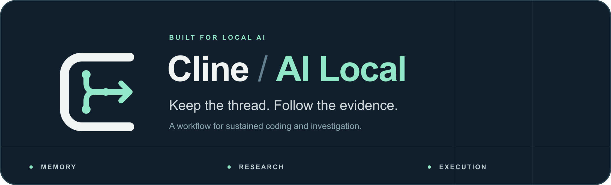
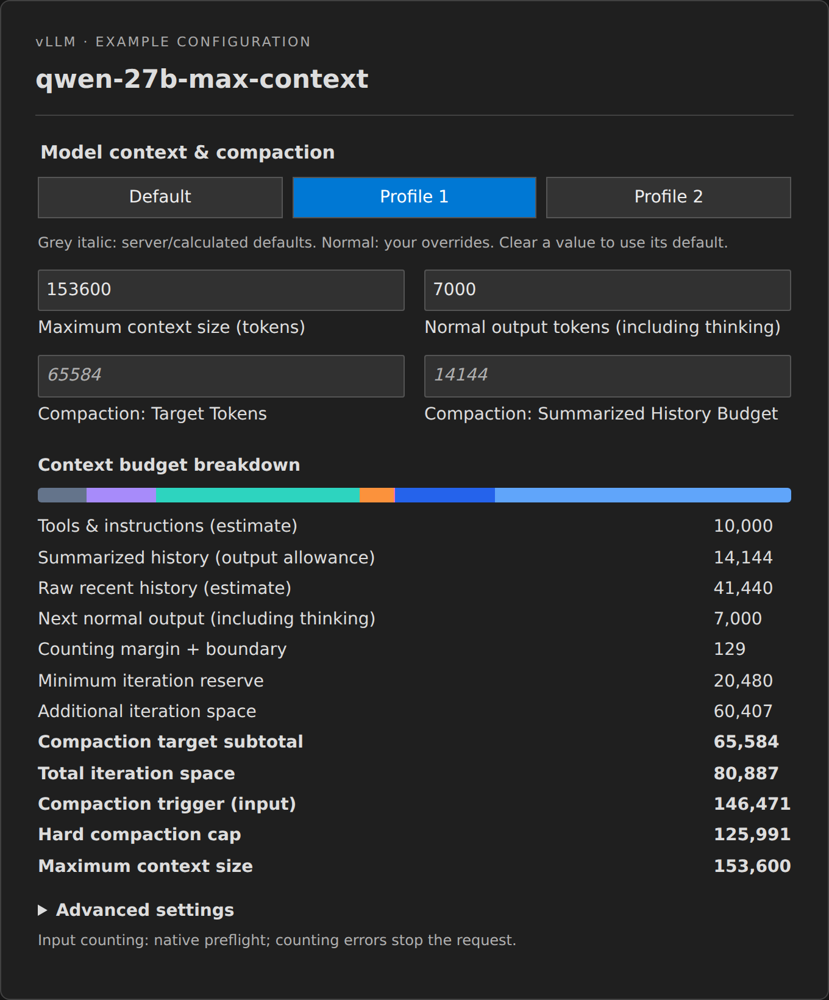

<!-- AI Local fork introduction. Preserve the upstream README below its marker. -->
<p align="center">
  
</p>

<p align="center">
  <strong>Keep the thread. Follow the evidence. Finish the work.</strong>
</p>

**Cline / AI Local** brings session memory, focused research, and execution you can follow to local-model workflows in the **CLI and VS Code**. It grows out of everyday coding and investigation with models running on your own hardware: keeping useful knowledge across sessions, finding the right evidence, and following a command through to its result.

Context is one part of that workflow. The aim is to make the model, its working memory, and its tools work well together over sustained tasks.

### See and control your model's working budget

The native model configuration screen puts **context allocation, compaction, output and reasoning controls** in one place. Its breakdown shows tools and instructions, summarized history, raw recent history, output including thinking, counting margin, and the space reserved for further iterations.

**Default, Profile 1 and Profile 2 are saved per provider/server/model.** Switch between a long investigation and a tighter working budget without rebuilding the settings each time. Grey italic values distinguish server/calculated defaults from your overrides. CLI model selection uses the same saved slots, and both clients display the selected model ID and profile.

<p align="center">
  
</p>

*The actual settings component, rendered with example values and Profile 1 selected. Tools/instructions and recent-history allocations are estimates; supported native counters verify the prepared request at runtime. [Screenshot details](assets/screenshots/README.md).*

### What this fork provides

- **Native model configuration.** vLLM and llama.cpp controls expose sampling, thinking, context/output limits and compaction budgets. Per-model profile slots, editable token-cost estimates, model discovery and visible IDs keep the CLI and editor aligned. HyperQwen uses the vLLM provider; llama-swap can route requests without Cline guessing the inference engine.
- **Memory built from the work.** Compaction records actions and results, user requirements, design and API knowledge learned from code/docs, corrections, and unresolved work. Whole messages and tool exchanges stay together. Oldest notes are reduced together only when the summary exceeds its budget. Model-generated summaries remain imperfect; full saved history is retained.
- **Continuity across recovery and revisions.** Resume, checkpoint/Undo and edited-message fixes preserve validated compaction state and the working context. Prepared requests retain stable summarized prefixes where possible, supporting prefix-cache reuse.
- **Research with evidence in reach.** Search, save pages outside the conversation, find relevant passages, and read only the lines needed. The model can revisit sources without carrying whole pages in context. Search and page acquisition have configurable providers, including the optional SearXNG plugin.
- **Commands that remain trackable.** Native/headless commands that outlast the foreground wait continue under the same PID, with captured output and a log for later results. Identity-aware process waits and verified expert-status waits avoid repeated shell polling and false loop failures. Visible VS Code terminals retain their own terminal-specific handoff.
- **Native editing with staged drafts.** Bounded reads, file hashes, exact-range edits and conflict checks are built into the toolset. Large content can be assembled in chunks before a guarded apply; editor previews and commits use the same underlying engine.
- **A reusable setup for sustained work.** The opt-in [bootstrap kit](bootstrap/README.md) includes portable rule supplements, a Codex-backed `consult-expert` MCP for explicitly requested expert assignments, and CLI hooks for completion, errors and questions waiting for an answer. These are supplied as setup material, not silently activated by installing Cline.

Underneath those workflows are native request counting and budget admission, bounded reasoning previews, code-server logging and transport repairs, and matched CLI/extension builds with source provenance. The [fork modification inventory](docs/fork-differences.md) maps these changes to their implementation and integration history.

### Why this fork exists

The first change addressed a code-server memory leak: closing the output channel could trigger recursive logging during logout. That repair is documented in [PR #15066 — prevent closed output channel logging recursion](https://github.com/cline/cline/pull/15066).

The scope has grown into an integrated environment for working with local models. The improvements come from actual failures and repeated friction in long coding and research sessions, rather than treating a larger context window as the solution to every problem.

This remains a Cline fork. It continues to integrate upstream development, preserves Cline's authorship and license, and can retire local changes as upstream provides equivalent or better behavior.

### Builds and upstream

CLI and extension releases share one fork version, **`year.month.release`** (for example, `2026.10.1`). Development builds record their exact source commit without moving a release tag. Both clients are built from the same committed SDK source, with provenance, a shared runtime fingerprint and artifact hashes.

See [local builds and releases](local/README.md), the [development workflow](LOCAL_DEVELOPMENT.md), and the [fork's branding assets](assets/branding/README.md). The capabilities above describe this fork's current source; use the build receipt to identify what an installed package contains.

The original Cline README follows. Its installation commands and product links describe **upstream Cline**; they do not install this fork. Cline's original authorship and license are preserved.

---

<!-- BEGIN UPSTREAM CLINE README -->

<h1 align="center">Cline</h1>

<p align="center">
The open source coding agent in your IDE, terminal, & desktop!
</p>

<div align="center">

<div align="center">
<table>
<tbody>
<td align="center">
<a href="https://docs.cline.bot" target="_blank"><strong>Docs</strong></a>
</td>
<td align="center">
<a href="https://discord.gg/cline" target="_blank"><strong>Discord</strong></a>
</td>
<td align="center">
<a href="https://www.reddit.com/r/cline/" target="_blank"><strong>r/cline</strong></a>
</td>
<td align="center">
<a href="https://github.com/cline/cline/discussions/categories/feature-requests?discussions_q=is%3Aopen+category%3A%22Feature+Requests%22+sort%3Atop" target="_blank"><strong>Feature Requests</strong></a>
</td>
<td align="center">
<a href="https://cline.bot/join-us" target="_blank"><strong>Join us!</strong></a>
</td>
</tbody>
</table>
</div>

</div>

<br>

<div align="center">
<table>
<tr>
<td align="center" width="50%">

### CLI

Run Cline in your terminal.
Interactive chat or fully headless 
for CI/CD and scripting.

```
npm i -g cline
```

<a href="./apps/cli/README.md">Learn more</a>
<br><br>

</td>
<td align="center" width="50%">

### Desktop App

Cline as a native app for macOS and Windows.
Run agent sessions in any folder, schedule
routines, and manage models, plugins, and MCP servers.

<a href="https://cline.bot/desktop">Download for macOS and Windows</a>
<br><br>

</td>
</tr>
<tr>
<td align="center" width="50%">

### VS Code Extension

AI coding assistant in your editor.
Create files, run commands, browse the web,
and use tools with human-in-the-loop approval.

<a href="https://marketplace.visualstudio.com/items?itemName=saoudrizwan.claude-dev">Install from VS Marketplace</a>
<br><br>

</td>
<td align="center" width="50%">

### JetBrains Plugin

The same Cline experience in IntelliJ IDEA,
PyCharm, WebStorm, GoLand, and the rest of
the JetBrains family.

<a href="https://plugins.jetbrains.com/plugin/28247-cline">Install from JetBrains Marketplace</a>
<br><br>

</td>
</tr>
</table>
</div>

<div align="center">
<table>
<tr>
<td align="center">

### SDK

Build your own AI agents and integrations powered by the same engine that runs the CLI, desktop app, VS Code extension, and JetBrains plugin. Custom tools, multi-agent teams, connectors, scheduled automations, and more.

```
npm install @cline/sdk
```

<a href="https://docs.cline.bot/cline-sdk/overview">Documentation</a>
<br><br>

</td>
</tr>
</table>
</div>

---

## Index

| Product | Description | Location | CHANGELOG |
|---------|------------|--------------|--------------|
| **SDK** | Node.js programmatic agent API and extension exports. | [`sdk/`](https://github.com/cline/cline/tree/main/sdk) | [CHANGELOG.md](https://github.com/cline/cline/blob/main/sdk/CHANGELOG.md) |
| **CLI** | Terminal UI, headless mode, shell commands, and CLI-specific flows. | [`apps/cli/`](https://github.com/cline/cline/tree/main/apps/cli) | [CHANGELOG.md](https://github.com/cline/cline/blob/main/apps/cli/CHANGELOG.md) |
| **VS Code Extension** | The Marketplace extension and extension host integration. | [`apps/vscode/`](https://github.com/cline/cline/tree/main/apps/vscode) | [CHANGELOG.md](https://github.com/cline/cline/blob/main/CHANGELOG.md) |
| **Desktop App** | Native macOS and Windows app (Tauri shell, Bun sidecar, Next.js UI). | [`apps/examples/desktop-app/`](https://github.com/cline/cline/tree/main/apps/examples/desktop-app) | [CHANGELOG.md](https://github.com/cline/cline/blob/main/apps/examples/desktop-app/CHANGELOG.md) |
| **JetBrains Plugin** | JetBrains-hosted client that talks to the shared agent core. | Currently we are not open-sourcing JetBrains plugins | - |
| **Docs site** | Public documentation pages. | [`docs/`](https://docs.cline.bot/) | - |

## Edits Code Across Your Project

Cline reads your project structure, understands the relationships between files, and makes coordinated changes across your codebase. It monitors linter and compiler errors as it works, fixing issues like missing imports, type mismatches, and syntax errors before you even see them. In VS Code and JetBrains, every edit shows up as a diff you can review, modify, or revert. All changes are tracked with checkpoints, so you can easily undo the agent's work.

## Runs Bash Commands

Cline executes commands directly in your terminal and watches the output in real time. Install packages, run build scripts, execute tests, deploy applications, manage databases. For long-running processes like dev servers, Cline continues working in the background and reacts to new output as it appears, catching compile errors, test failures, and server crashes as they happen.

## Plan and Act

Toggle between Plan mode and Act mode. In Plan mode, Cline explores your codebase, asks clarifying questions, and lays out a strategy. Once you're aligned, switch to Act mode and Cline executes the plan. Every file edit and terminal command requires your approval, so you stay in control of what actually changes. Or toggle auto-approve and let Cline run autonomously.

## Rules and Skills

Define project-specific rules in `.clinerules` files that guide how Cline works in your codebase: coding standards, architecture conventions, deployment procedures, testing requirements. Rules are picked up automatically by the CLI, VS Code extension, and JetBrains plugin. Use skills to let the model load specific rules when needed.

## Works With Every Model

Cline is not locked to a single AI provider. Use whichever model fits your workflow:

| Provider | Models |
|----------|--------|
| Anthropic | Claude Opus, Sonnet, Haiku |
| OpenAI | GPT series models |
| Google | Gemini series models |
| OpenRouter | 200+ models from any provider |
| Vercel AI Gateway | Route to many providers through one gateway |
| AWS Bedrock | Claude, Llama, and more |
| Azure / GCP Vertex | All hosted models |
| Cerebras / Groq | Fast inference models |
| Ollama / LM Studio | Run local models on your machine |
| Any OpenAI-compatible API | Self-hosted or third-party endpoints |

## Extend With Plugins or MCP Servers

Extend Cline's capabilities with plugins. Using the SDK, register tools and lifecycle hooks programmatically through the plugin system for logging, auditing, policy enforcement, or adding domain-specific capabilities. Simple plugin example below.

```typescript
import { Agent, createTool } from "@cline/sdk"

const deployTool = createTool({
  name: "deploy",
  description: "Deploy the current branch to staging.",
  inputSchema: { type: "object", properties: { env: { type: "string" } }, required: ["env"] },
  execute: async (input) => {
    // your deployment logic
  },
})

const agent = new Agent({ tools: [deployTool], /* ... */ })
```
...or use [MCPs](https://github.com/modelcontextprotocol) to connect to databases, query APIs, manage cloud infrastructure, and interact with external systems. Use [community-built servers](https://github.com/modelcontextprotocol/servers) or ask Cline to create custom tools on the fly. In the CLI, manage servers with `cline mcp`.

## Multi-Agent Teams

Coordinate multiple agents working together on complex tasks. A coordinator agent breaks the work into subtasks and delegates to specialist agents, each with their own tools and context. Team state persists across sessions so you can pick up where you left off.

```bash
cline --team-name auth-sprint "Plan and implement user authentication with tests"
```

## Scheduled Agents

Run agents on cron schedules for recurring automations. Daily PR summaries, weekly dependency checks, codebase health reports. Schedules persist across restarts and run independently of any terminal session.

```bash
cline schedule create "PR summary" \
  --cron "0 9 * * MON-FRI" \
  --prompt "List all open PRs and their review status" \
  --workspace /path/to/repo
```

## Connect to Slack, Telegram, Discord, and More

Chat with your agent from any messaging platform: Telegram, Slack, Discord, Google Chat, WhatsApp, and Linear. Each conversation thread maps to an agent session with full context. Set up access control to restrict who can interact with your agent.

```bash
# Connect to Telegram
cline connect telegram -k $BOT_TOKEN
# Connect to Slack through webhook
cline connect slack --bot-token $SLACK_TOKEN --signing-secret $SECRET --base-url $URL
# Connect to Slack using socket mode
cline connect slack --bot-token $SLACK_TOKEN --app-token $SLACK_APP_TOKEN
```

## Headless CLI for CI/CD

Run Cline with zero interaction for scripting and automation. Pipe input, get JSON output, chain commands, integrate into CI/CD pipelines.

```bash
cline "Run tests and fix any failures"
git diff origin/main | cline "Review these changes for issues"
cline --json "List all TODO comments" | jq -r 'select(.type == "agent_event" and .event.text) | .event.text'
```

## Contributing

Start with the [Contributing Guide](CONTRIBUTING.md). Join our [Discord](https://discord.gg/cline) and head to the `#contributors` channel to connect with other contributors. Check our [careers page](https://cline.bot/join-us) for full-time roles.

## License

[Apache 2.0 © 2026 Cline Bot Inc.](./LICENSE)
